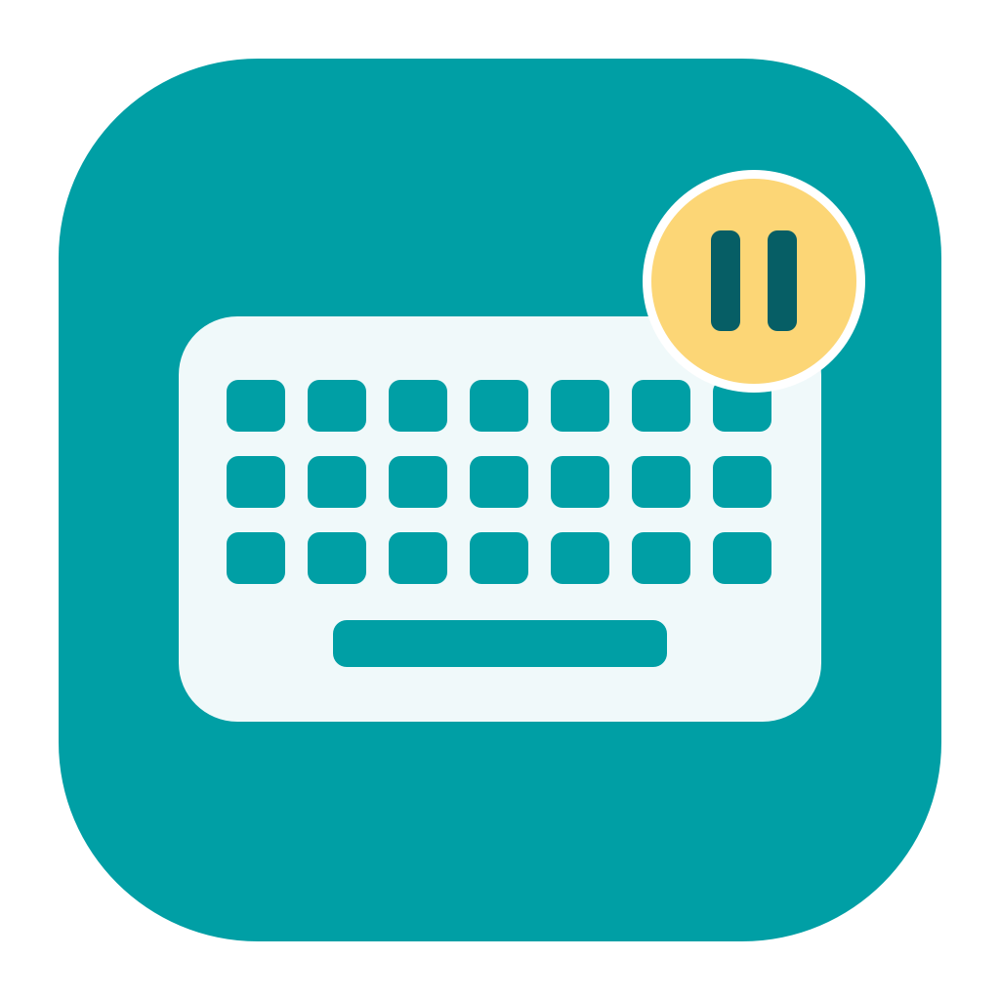

# 键盘小憩 · Keyboard Pause



[下载 v1.2.1](https://github.com/Hobielove/keyboard-pause/releases/tag/v1.2.1) · Apple Silicon · 本地临时签名，未公证

一个小巧的 macOS 键盘清洁助手。版本 1.2.1。

- 一键暂时屏蔽键盘，鼠标和触控板继续可用。
- 后台固定 3 分钟自动恢复，也可点击按钮或菜单栏恢复。
- 前台虚拟键盘显示按键高亮，不记录输入历史，不联网。
- 浅色界面、实心色块键盘，无订阅、无内置到期机制。

## 构建
需要 Apple Silicon Mac 和 Apple Command Line Tools。目标 macOS 13+；已在 macOS 26.4.1 上编译和检查布局。

```sh
bash build.sh
```

构建结果在当前目录的上一级：`键盘小憩.app`。首次使用需要在系统设置的辅助功能中授权。临时签名的应用更新后，可能需要移除旧授权条目并重新添加。当前版本没有 Developer ID 签名或公证。

## 测试
```sh
swiftc LockPolicy.swift PolicyTests.swift -o /tmp/keyboardpause-policy-tests
/tmp/keyboardpause-policy-tests
swiftc -framework AppKit KeyboardView.swift KeyboardTests.swift -o /tmp/keyboardpause-keyboard-tests
/tmp/keyboardpause-keyboard-tests
```

输入过滤、超时边界和键位状态测试通过，不等于每种设备与系统场景下的真实拦截验收。早期版本已获使用者确认可清洁；最新版本仍需授权后验证真实拦截与完整三分钟计时。

## 限制
电源键、Touch ID、硬件强制关机无法屏蔽。系统保留操作、安全输入和特殊驱动不能保证被拦截。不是锁屏安全工具。不要向键盘直接喷液体。
按键显示采用 Mac ANSI 布局；不覆盖 ISO/JIS 特殊键和数字小键盘。仅在本窗口前台且未清洁时显示按键。
没有内置到期日期不代表未来所有 macOS 都无需适配。

## 许可
MIT。此项目为独立实现，不包含 KeyboardCleanTool 的代码或资源。
